# AWS 웹 서비스 배포 실습

서울 리전(`ap-northeast-2`)의 Public Subnet에 EC2를 배치하고, Docker Nginx로 정적 웹페이지를 배포했다. **외부 접속 검증 방식은 B(`GET /health`)**이며, 2026-11-06 12:03:16 KST에 외부 iMac에서 `200 OK`와 본문 `OK`를 확인했다. 아래 결과는 직접 수행하여 제공한 터미널 로그를 기준으로 기록했다. 실행 및 접속 증빙은 터미널 로그로 기록하며, 아키텍처 다이어그램은 Mermaid와 PNG로 작성했으며, 주요 실습 리소스는 EC2부터 VPC까지 정리했다. 상세 완료 근거와 추가 확인 항목은 12~13번에 기록했다.

# 1. IAM->정책->정책생성
정책 편집기에서 (JSON으로 선택후) 아래내용 붙여넣음
```
{
  "Version": "2012-10-17",
  "Statement": [
    {
      "Sid": "AllowReadEC2AndVPC",
      "Effect": "Allow",
      "Action": [
        "ec2:Describe*",
        "ec2:GetConsoleOutput",
        "ec2:GetConsoleScreenshot"
      ],
      "Resource": "*",
      "Condition": {
        "StringEquals": {
          "aws:RequestedRegion": "ap-northeast-2"
        }
      }
    },
    {
      "Sid": "AllowWebLabManagement",
      "Effect": "Allow",
      "Action": [
        "ec2:CreateVpc",
        "ec2:DeleteVpc",
        "ec2:CreateSubnet",
        "ec2:DeleteSubnet",
        "ec2:ModifySubnetAttribute",
        "ec2:CreateInternetGateway",
        "ec2:AttachInternetGateway",
        "ec2:DetachInternetGateway",
        "ec2:DeleteInternetGateway",
        "ec2:CreateRouteTable",
        "ec2:DeleteRouteTable",
        "ec2:CreateRoute",
        "ec2:DeleteRoute",
        "ec2:AssociateRouteTable",
        "ec2:DisassociateRouteTable",
        "ec2:CreateSecurityGroup",
        "ec2:DeleteSecurityGroup",
        "ec2:AuthorizeSecurityGroupIngress",
        "ec2:RevokeSecurityGroupIngress",
        "ec2:AuthorizeSecurityGroupEgress",
        "ec2:RevokeSecurityGroupEgress",
        "ec2:CreateKeyPair",
        "ec2:DeleteKeyPair",
        "ec2:RunInstances",
        "ec2:TerminateInstances",
        "ec2:CreateTags",
        "ec2:DeleteVolume"
      ],
      "Resource": "*",
      "Condition": {
        "StringEquals": {
          "aws:RequestedRegion": "ap-northeast-2"
        }
      }
    }
  ]
}
```
JSON을 입력한 다음
1. 다음(Next) 버튼을 클릭합니다.
2. 정책 이름에 web-lab-policy를 입력합니다.
3. 설명에 AWS EC2 VPC Web Lab Permissions를 입력합니다.
4. 정책 생성(Create policy)을 클릭합니다.

# 2. IAM->IAM 사용자->그룹생성
IAM > IAM 사용자 > 사용자 생성 에서 그룹생성 버튼을 눌러서 사용자 그룹을 생성한다

사용자 그룹이름은 web-lab-group 으로 입력하고 
권한정책은 검색창에 web-lab으로 입력한 후 정책생성버튼의 동그라미형태의 Refresh버튼을 누르고
web-lab-policy 정책이 화면에 보이면 체크박스를 선택한다.
그리고 사용자 그룹 생성 버튼을 클릭한다.
 


# 3. VPC생성
위에서 생성된 IAM 사용자 로그인 URL을 확인하고 보관합니다.
## STEP 1. 새로운 IAM 사용자로 로그인
1. 현재 AWS 콘솔에서 로그아웃합니다.
2. IAM 사용자 로그인 페이지로 이동합니다.
3. 다음 정보를 입력합니다.
항목	입력
계정 ID	본인 AWS 계정의 12자리 ID
IAM 사용자 이름	web-lab-user
암호	사용자 생성 시 설정한 암호

## STEP 2. 서울 리전 선택
AWS 콘솔 오른쪽 위의 리전 선택 메뉴에서 다음을 선택합니다.

아시아 태평양(서울) ap-northeast-2

IAM 화면에서는 글로벌이라고 표시될 수 있지만, VPC를 만드는 화면에서는 서울 리전이어야 합니다.

## STEP 3. VPC 생성
AWS 콘솔 상단 검색창에 VPC 입력

VPC → Your VPCs(VPC) → Create VPC(VPC 생성) 선택

다음과 같이 입력합니다.
항목	설정값
생성할 리소스	VPC만(VPC only)
이름 태그	web-lab-vpc
IPv4 CIDR	10.0.0.0/16
IPv6 CIDR	IPv6 CIDR 블록 없음
테넌시	기본값(Default)

VPC 생성 후의 상태
VPC: web-lab-vpc

10.0.0.0/16
아직 Subnet과 EC2를 생성하지 않은 상태

마지막으로 VPC 생성(Create VPC) 버튼을 클릭합니다.

VPC가 정상적으로 생성되면 상태가 Available로 나타납니다.

---

# 4. Public Subnet 생성

> **진행 상태: 서브넷 생성 및 퍼블릭 IPv4 자동 할당 확인 (아래 기록 참조)**
>
> 앞에서 생성한 VPC 정보: 이름 `web-lab-vpc`, ID `vpc-0c62583f604f44241`, IPv4 CIDR `10.0.0.0/16`, 리전 `ap-northeast-2`.
>
> 다음 절차의 실제 완료 여부는 AWS 콘솔에서 확인 후 체크한다. 스크린샷은 본인이 촬영한 것만 추가한다.

## STEP 1. 서브넷 생성

AWS 콘솔(서울 리전) → **VPC → 서브넷(Subnets) → 서브넷 생성(Create subnet)**으로 이동한다.

| 항목 | 입력값 |
|---|---|
| VPC ID | `web-lab-vpc` (`vpc-0c62583f604f44241`) |
| 서브넷 이름 | `web-lab-public-subnet` |
| 가용 영역 | `ap-northeast-2a` (선택 가능한 영역 확인) |
| IPv4 서브넷 CIDR | `10.0.1.0/24` |
| 태그 키 / 값 | `Name` / `web-lab-public-subnet` |

**왜 이 주소를 사용하는가?** VPC `10.0.0.0/16` 안에서 서브넷 `10.0.1.0/24`라는 더 작은 네트워크를 나눈 것이다. 서브넷을 생성하는 것만으로 인터넷에 공개되는 것은 아니다.

**생성 후 작업:** 서브넷 선택 → **작업(Actions) → 서브넷 설정 편집(Edit subnet settings)** → **퍼블릭 IPv4 자동 할당(Enable auto-assign public IPv4 address)** 활성화 후 저장. 이 설정과 함께 EC2 생성 시 자동 할당 옵션도 확인한다. 공인 IPv4는 과금될 수 있다.

**확인 및 증빙:** 서브넷 ID, VPC ID, CIDR, 자동 할당 설정 화면
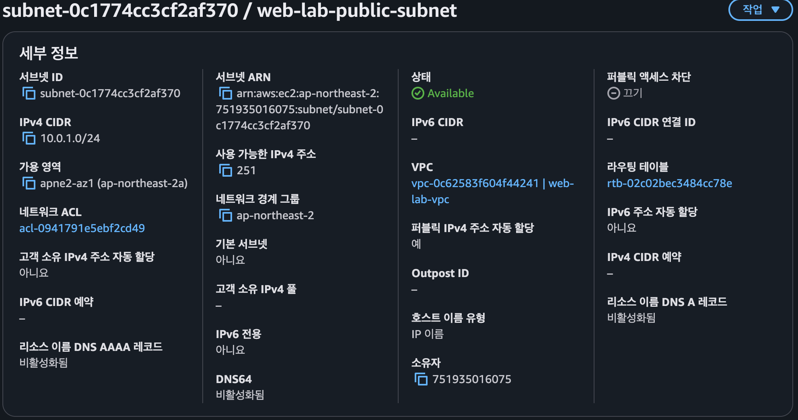

### 실제 AWS 화면 확인 (2026-11-05)

| 확인 항목 | 스크린샷에서 확인된 값 |
|---|---|
| 서브넷 이름 | `web-lab-public-subnet` |
| 서브넷 ID | `subnet-0c1774cc3cf2af370` |
| VPC ID | `vpc-0c62583f604f44241` |
| IPv4 CIDR | `10.0.1.0/24` |
| 가용 영역 | `ap-northeast-2a` (`apne2-az1`) |
| 서브넷 상태 | `Available` |
| 퍼블릭 IPv4 자동 할당 | **예 (2026-11-05 화면으로 확인)** |

# 5. Internet Gateway 생성과 VPC 연결

1. **VPC → 인터넷 게이트웨이(Internet gateways) → 인터넷 게이트웨이 생성**을 선택한다.
2. 이름 태그: `web-lab-igw` 입력 후 생성한다.
3. 생성한 IGW를 선택해 **작업 → VPC에 연결(Attach to VPC)**을 선택한다.
4. 연결할 VPC로 `web-lab-vpc`를 선택한다.
5. 연결 상태가 **Attached**인지 확인한다.

**왜 필요한가?** Internet Gateway는 인터넷과 VPC 간에 왕복 통신이 가능하도록 연결하는 관문이다. 단, IGW 연결만으로 외부 접속이 보장되지는 않는다. 라우팅과 보안 그룹도 맞아야 한다.

**증빙:** 
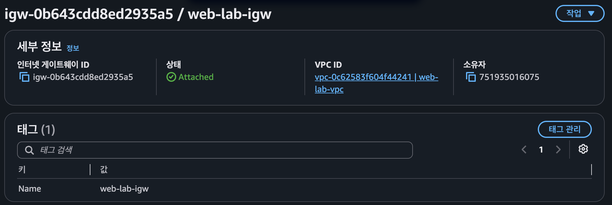

# 6. Public Route Table 생성과 서브넷 연결

1. **VPC → 라우팅 테이블(Route tables) → 라우팅 테이블 생성**으로 이동한다.
2. 이름: `web-lab-public-rt`, VPC: `web-lab-vpc`를 선택한다.
3. 생성한 테이블 → **라우팅(Routes) → 라우팅 편집(Edit routes)**을 선택한다.
4. `0.0.0.0/0` 목적지의 대상(Target)을 앞에서 만든 `web-lab-igw`로 설정하여 추가한다.
5. **서브넷 연결(Subnet associations) → 명시적 서브넷 연결 편집**에서 `web-lab-public-subnet`을 선택하고 저장한다.

기대하는 라우팅 규칙:

| 목적지(Destination) | 대상(Target) | 의미 |
|---|---|---|
| `10.0.0.0/16` | `local` | VPC 내부 네트워크 |
| `0.0.0.0/0` | `igw-...` | 나머지 IPv4 주소로 향하는 인터넷 트래픽 |

**왜 필요한가?** IGW를 만들더라도 서브넷에서 사용하는 라우팅 테이블에 인터넷 기본 경로가 없으면 EC2가 이 경로로 인터넷에 나갈 수 없다. 이 연결이 있어야 서브넷을 Public Subnet으로 사용할 수 있다.

**증빙:** 
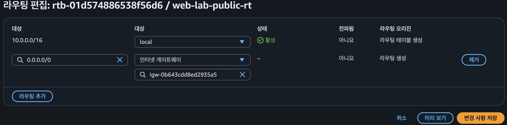
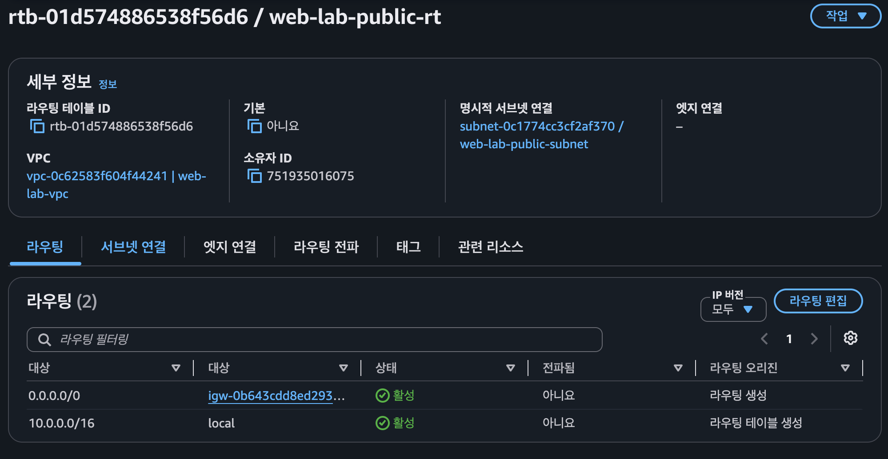


# 7. Security Group 생성

1. **EC2 → 보안 그룹(Security Groups) → 보안 그룹 생성**으로 이동한다.
2. 이름: `web-lab-sg`, 설명: `HTTP 80 public, SSH 22 my IP`, VPC: `web-lab-vpc`.
3. **인바운드 규칙**을 다음과 같이 설정한다.

| 유형 | 프로토콜/포트 | 소스 |
|---|---|---|
| HTTP | TCP / 80 | `0.0.0.0/0` |
| SSH | TCP / 22 | **내 IP(My IP)**, 즉 `실제공인IP/32` |

아웃바운드는 이번 실습에서는 기본 허용 규칙(인터넷 요청용)을 사용한다.

- `0.0.0.0/0`은 모든 IPv4 주소를 뜻한다. 웹 공개용 **HTTP 80**에서만 사용한다.
- SSH는 자신의 공인 IP만 허용한다. **SSH 22를 `0.0.0.0/0`으로 열지 않는다.**
- 인바운드에 전체 포트(0~65535)를 공개하는 규칙을 생성하지 않는다.
- **Security Group은 EC2 네트워크 접근 제어, IAM은 AWS 리소스 생성/삭제 권한 제어**이다.

**증빙:** 
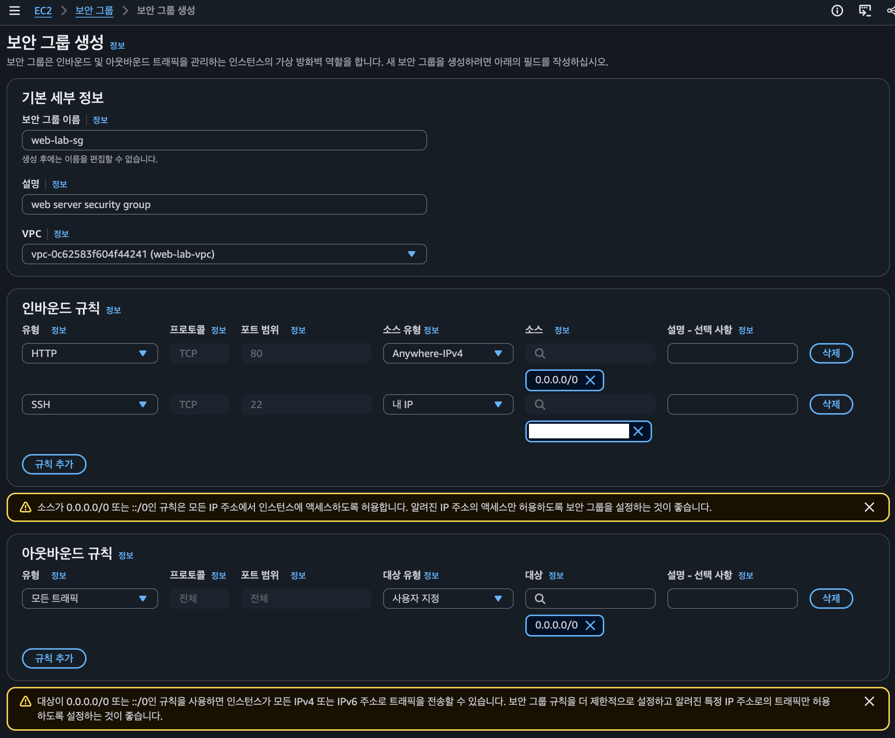

# 8. EC2 인스턴스 생성

AWS 콘솔 → **EC2 → 인스턴스(Instances) → 인스턴스 시작(Launch instances)**.

| 항목 | 설정 |
|---|---|
| 이름 | `web-lab-ec2` |
| AMI | Ubuntu Server LTS (24.04) |
| 인스턴스 유형 | t3.micro(프리티어사용가능) 1대 |
| 키페어 | 새 키페어 `web-lab-key` 생성, `web-lab-key.pem` 안전 보관 |
| VPC | `web-lab-vpc` |
| Subnet | `web-lab-public-subnet` |
| 퍼블릭 IP 자동 할당 | 활성화 |
| 기존 보안 그룹 | `web-lab-sg` |
| 루트 EBS | gp3 8~10 GiB |
| 종료 시 삭제(Delete on termination) | 활성화 |

**주의:** AWS 계정 생성 시점 및 혜택에 따라 무료 범위가 다르며, 자동 할당 공인 IPv4도 별도 비용 항목이 될 수 있다. 실습 종료 후 반드시 제거한다.

생성 후 **Running**, 상태 검사 통과, **Public IPv4 address 존재**, VPC/Subnet/SG 일치를 확인한다. 공인 IP와 인스턴스 ID는 README의 '실제 검증 결과'에 기록한다(스크린샷에서는 필요한 정보만 공개).

**증빙:** 
VPC / Subnet / SG 일치

EC2 실행 상태 보기
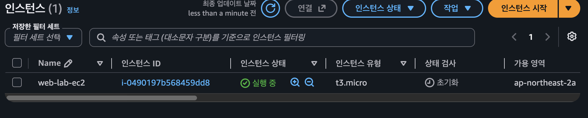
퍼블릭 IPv4존재
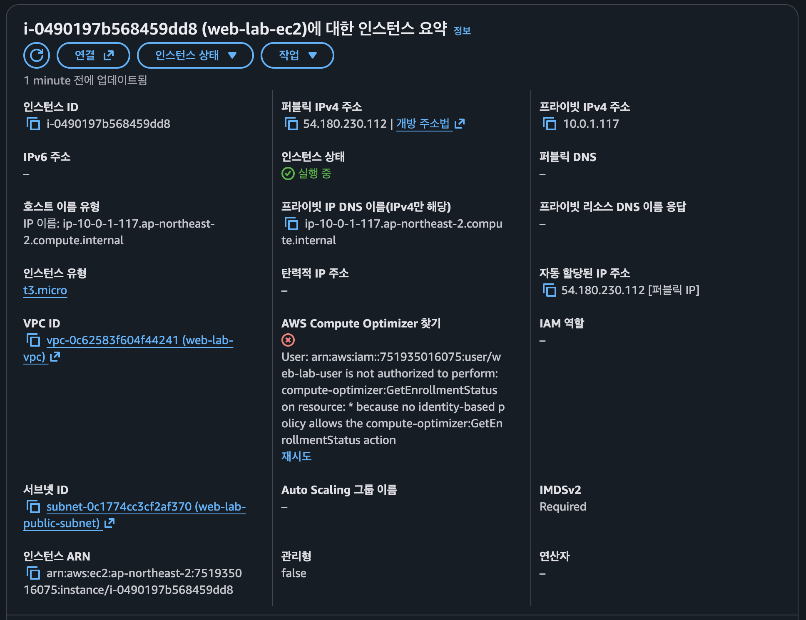
# 9. SSH 접속 및 Docker Nginx 배포

## STEP 1. Mac에서 SSH 접속

```bash
chmod 400 ~/Documents/web-lab-key.pem
ssh -i ~/Documents/web-lab-key.pem ubuntu@54.180.230.112
```

개인 키 권한 `0644`로 접속에 실패했으나 `0400`으로 변경한 후 접속에 성공했다. 상세 오류·조치·성공 로그는 [트러블슈팅 보고서](docs/troubleshooting.md)에 기록했다.

## STEP 2. Docker 설치

Docker 공식 저장소를 등록하기 위해 인증서와 curl을 설치하고 서명 키를 저장한다. 설치 과정의 원본 출력은 별도로 제공되지 않았으므로 아래는 실행 명령을 기록한다.

```bash
sudo apt update
sudo apt install -y ca-certificates curl
sudo install -m 0755 -d /etc/apt/keyrings
sudo curl -fsSL https://download.docker.com/linux/ubuntu/gpg -o /etc/apt/keyrings/docker.asc
sudo chmod a+r /etc/apt/keyrings/docker.asc
```

Ubuntu 24.04(`noble`), x86_64(`amd64`) 환경에 맞는 Docker 공식 APT 저장소를 등록한다.

```bash
sudo tee /etc/apt/sources.list.d/docker.sources > /dev/null <<'EOF'
Types: deb
URIs: https://download.docker.com/linux/ubuntu
Suites: noble
Components: stable
Architectures: amd64
Signed-By: /etc/apt/keyrings/docker.asc
EOF
```

패키지 목록을 갱신한 뒤 Docker Engine, Buildx, Compose 플러그인을 설치하고 Docker 서비스를 실행한다.

```bash
sudo apt update
sudo apt install -y docker-ce docker-ce-cli containerd.io docker-buildx-plugin docker-compose-plugin
sudo systemctl enable --now docker
```

## STEP 3. Docker 설치 확인

호스트에는 Nginx 패키지를 설치하지 않고, Docker 컨테이너로 실행했다. Docker 공식 APT 저장소를 등록해 Engine과 Compose 플러그인을 설치했다. 다음 명령은 **EC2 Ubuntu 터미널**에서 실행한다.

Docker Engine의 Client와 Server 버전을 확인한다.

```text
ubuntu@ip-10-0-1-117:~$ sudo docker version
Client: Docker Engine - Community
 Version:           29.9.3
 API version:       1.56
 Go version:        go1.26.10
 Git commit:        5457199
 Built:             Tue Nov  3 21:41:31 2026
 OS/Arch:           linux/amd64
 Context:           default

Server: Docker Engine - Community
 Engine:
  Version:          29.9.3
  API version:      1.56 (minimum version 1.40)
  Go version:       go1.26.10
  Git commit:       70efc0e
  Built:            Tue Nov  3 21:41:31 2026
  OS/Arch:          linux/amd64
  Experimental:     false
 containerd:
  Version:          v2.4.2
  GitCommit:        b7a25261e029d68978bbf290df0a62fc819b3c51
 runc:
  Version:          1.5.2
  GitCommit:        v1.5.2-0-g29dd3dc2
 docker-init:
  Version:          0.19.0
  GitCommit:        de40ad0
```

Docker Compose 설치 버전을 확인한다. 이번 배포는 Compose 대신 `docker run`을 사용했다.

```text
ubuntu@ip-10-0-1-117:~$ sudo docker compose version
Docker Compose version v5.7.0
```

Docker 서비스가 실행 중인지 확인한다.

```text
ubuntu@ip-10-0-1-117:~$ systemctl is-active docker
active
```

Client와 Server 버전이 모두 출력되고 서비스 상태가 `active`이므로 Docker 설치 및 실행을 확인했다.

## STEP 4. EC2 웹페이지 폴더 준비

웹페이지를 EC2에서 직접 수정할 수 있도록 폴더를 만들고, HTML 페이지와 고정 응답 `OK`를 반환할 health 파일을 작성한다. 아래는 파일 생성 명령이다.

```bash
mkdir -p /home/ubuntu/web-lab/html

cat > /home/ubuntu/web-lab/html/index.html <<'EOF'
<!doctype html>
<html lang="ko">
<head>
  <meta charset="utf-8">
  <title>AWS Web Lab</title>
</head>
<body>
  <h1>Hello Cloud</h1>
  <p>Docker Nginx로 서비스 중입니다.</p>
</body>
</html>
EOF

echo OK > /home/ubuntu/web-lab/html/health
```

## STEP 5. 바인드 마운트로 Nginx 실행

EC2의 웹페이지 폴더를 컨테이너 웹 루트에 읽기 전용으로 연결하고, 호스트 80번 포트로 요청을 받도록 Nginx를 실행한다. 아래는 실제 실행 명령과 이미지 다운로드 결과다.

```text
ubuntu@ip-10-0-1-117:~$ sudo docker run -d \
  --name web-lab-nginx \
  --restart unless-stopped \
  -p 80:80 \
  --mount type=bind,source=/home/ubuntu/web-lab/html,target=/usr/share/nginx/html,readonly \
  nginx:stable
Unable to find image 'nginx:stable' locally
stable: Pulling from library/nginx
2fc2bc44a8d3: Pull complete
37fb86c2a767: Pull complete
b532f9701850: Pull complete
f7214361b33f: Pull complete
cbbdc282ecf5: Pull complete
9c0452afd4ee: Pull complete
89e2dd8a6236: Pull complete
1e24db3ea44b: Download complete
47835a5e6782: Download complete
Digest: sha256:42c68eab6f7e22611786a9fe1d1c019e275c50185bd54b8f75dc2b9184322703
Status: Downloaded newer image for nginx:stable
3a5ae8a1a592d79d3d2a53fd73de55e986590a3d537a781d3be65826d385f8d4
```

위 명령은 최초 생성 시 사용한 명령이다. 같은 이름의 컨테이너가 이미 실행 중이면 다시 실행하지 않는다.

| 항목 | 실제 구성 |
|---|---|
| 이미지 | `nginx:stable` |
| 이미지 Digest | `sha256:42c68eab6f7e22611786a9fe1d1c019e275c50185bd54b8f75dc2b9184322703` |
| 응답 서버 버전 | `nginx/1.30.6` |
| 컨테이너 | `web-lab-nginx` (`3a5ae8a1a592`) |
| 포트 매핑 | EC2 TCP 80 → 컨테이너 TCP 80 |
| EC2 웹페이지 폴더 | `/home/ubuntu/web-lab/html` |
| 컨테이너 웹 루트 | `/usr/share/nginx/html` |
| 마운트 권한 | 컨테이너에서 읽기 전용 (`readonly`) |
| 재시작 정책 | `unless-stopped` |

EC2 폴더 안의 정적 파일을 수정하면 컨테이너 재시작 없이 다음 요청에 반영된다. Mac의 파일을 수정한 경우에는 EC2 폴더에 전송해야 한다. React/Vite 프로젝트는 빌드 결과물을 배포한다.

트래픽은 Internet Gateway를 통해 EC2에 도달하고, 보안 그룹의 HTTP 80 허용 규칙과 Docker의 `80:80` 매핑을 거쳐 컨테이너로 전달된다. Docker 사용을 위해 기존 VPC/Subnet/Route Table을 변경하거나 추가 포트를 공개하지 않았다.

# 10. 내부·외부 접속 검증 결과

## STEP 1. EC2 내부 검증

컨테이너 실행 상태와 공개 포트 매핑을 확인하기 위해 `sudo docker ps`를 실행한다.

```text
ubuntu@ip-10-0-1-117:~$ sudo docker ps
CONTAINER ID   IMAGE          COMMAND                  CREATED          STATUS          PORTS                                 NAMES
3a5ae8a1a592   nginx:stable   "/docker-entrypoint.…"   18 seconds ago   Up 17 seconds   0.0.0.0:80->80/tcp, [::]:80->80/tcp   web-lab-nginx
```

EC2의 80번 포트를 통해 웹페이지가 제공되는지 확인하기 위해 localhost로 HTTP 요청을 보낸다.

```text
ubuntu@ip-10-0-1-117:~$ curl -i http://localhost
HTTP/1.1 200 OK
Server: nginx/1.30.6
Date: Fri, 06 Nov 2026 03:01:04 GMT
Content-Type: text/html
Content-Length: 197
Last-Modified: Fri, 06 Nov 2026 02:38:38 GMT
Connection: keep-alive
ETag: "6aed3dae-c5"
Accept-Ranges: bytes

<!doctype html>
<html lang="ko">
<head>
  <meta charset="utf-8">
  <title>AWS Web Lab</title>
</head>
<body>
  <h1>Hello Cloud</h1>
  <p>Docker Nginx로 서비스 중입니다.</p>
</body>
</html>
```

헬스체크 경로가 HTTP 200과 고정 응답 `OK`를 반환하는지 확인한다.

```text
ubuntu@ip-10-0-1-117:~$ curl -i http://localhost/health
HTTP/1.1 200 OK
Server: nginx/1.30.6
Date: Fri, 06 Nov 2026 03:01:21 GMT
Content-Type: application/octet-stream
Content-Length: 3
Last-Modified: Fri, 06 Nov 2026 02:40:00 GMT
Connection: keep-alive
ETag: "6aed3e00-3"
Accept-Ranges: bytes

OK
```

EC2에서 인터넷으로 아웃바운드 HTTPS 통신이 가능한지 확인하기 위해 외부 사이트의 응답 헤더를 조회한다.

```text
ubuntu@ip-10-0-1-117:~$ curl -I https://example.com
HTTP/2 200
date: Fri, 06 Nov 2026 03:01:52 GMT
content-type: text/html; charset=utf-8
server: cloudflare
last-modified: Wed, 04 Nov 2026 18:12:44 GMT
allow: GET, HEAD
accept-ranges: bytes
age: 13483
cf-cache-status: HIT
cf-ray: a560db2dbd780fff-ICN
alt-svc: h3=":443"; ma=86400
```

| 검증 | 실제 확인 결과 | 확인 시각 (KST) |
|---|---|---|
| 컨테이너 실행 | `Up 17 seconds`, `0.0.0.0:80->80/tcp`, `[::]:80->80/tcp` | 로그에 시각 없음 |
| 웹페이지 | `HTTP/1.1 200 OK`, `Hello Cloud` HTML 반환 | 2026-11-06 12:01:04 |
| 내부 `/health` | `HTTP/1.1 200 OK`, 본문 `OK` | 2026-11-06 12:01:21 |
| 외부 HTTPS 아웃바운드 | `HTTP/2 200` | 2026-11-06 12:01:52 |

## STEP 2. 외부 iMac에서 검증 (제출 방식 B)

외부에서 서비스에 접속할 수 있는지 확인하기 위해 EC2의 SSH 세션과 별개인 **외부 iMac 터미널**에서 공인 IP의 `/health`로 요청을 보낸다.

```text
Last login: Fri Nov  6 10:53:54 on ttys002
thinkover20221658@c4r6s1 ~ % curl -i http://54.180.230.112/health
HTTP/1.1 200 OK
Server: nginx/1.30.6
Date: Fri, 06 Nov 2026 03:03:16 GMT
Content-Type: application/octet-stream
Content-Length: 3
Last-Modified: Fri, 06 Nov 2026 02:40:00 GMT
Connection: keep-alive
ETag: "6aed3e00-3"
Accept-Ranges: bytes

OK
thinkover20221658@c4r6s1 ~ %
```

| 항목 | 실제 확인 결과 |
|---|---|
| 검증 방식 | **B: GET /health** |
| EC2 Public IPv4 | `54.180.230.112` |
| 공개 URL | `http://54.180.230.112/health` |
| 외부 접속 결과 | `200 OK`, 고정 응답 `OK` |
| 외부 검증 일시 | 2026-11-06 12:03:16 KST (응답 Date의 GMT를 변환) |

- [x] SSH 접속 성공
- [x] Docker 서비스 및 Nginx 컨테이너 실행 확인
- [x] localhost 웹페이지 HTTP 200 확인
- [x] EC2 내부 `/health` HTTP 200 및 OK 확인
- [x] EC2 아웃바운드 HTTPS HTTP 200 확인
- [x] 외부 iMac `/health` HTTP 200 및 OK 확인

실행 및 접속 증빙은 위 컨테이너 실행 로그, 내부 검증 결과 표, 외부 HTTP 응답 로그로 제시한다. 스크린샷은 별도로 제출하지 않는다. 원문 과제의 스크린샷 제출 조건은 이 문서에서 로그 증빙으로 대체했다.

> 검증 결과는 위 시점의 기록이다. EC2 종료/삭제나 공인 IP 변경 후에는 같은 URL로 접속할 수 없을 수 있다. 리소스 정리 전에 증빙을 확보한다.

# 11. 제출 산출물 만들기

실행 및 접속 증빙을 README의 로그로 제시하며, 나머지 제출 파일은 다음과 같다. 현재 없는 파일을 실제로 만들기 전까지는 완료로 표시하지 않는다.

```text
README.md
docs/architecture.png
docs/troubleshooting.md
docs/cleanup-checklist.md
```

## 11-1. 아키텍처 다이어그램

2026-11-06 검증 시점의 구성이다. 실선은 요청 흐름을, 점선은 설정 연결 및 파일 마운트를 나타낸다. Security Group과 Route Table은 중계 서버가 아닌 접근 제어·라우팅 설정이다.

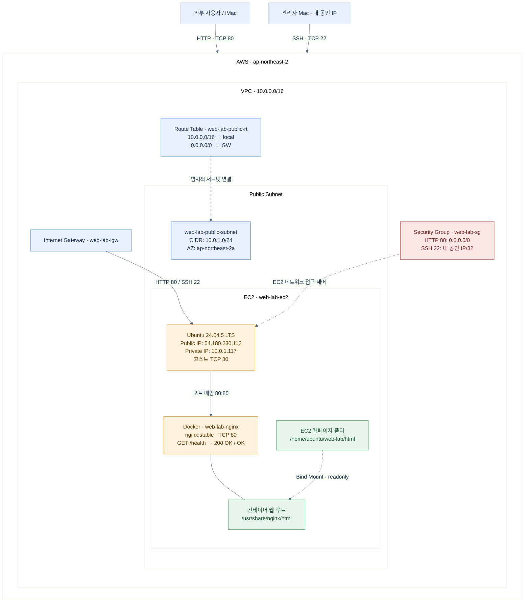

PNG 제출 파일: [architecture.png](docs/architecture.png) · 편집 원본: [architecture.mmd](docs/architecture.mmd)


## 11-2. 트러블슈팅 기록

[트러블슈팅 보고서](docs/troubleshooting.md)에 SSH 개인 키 권한 오류를 **증상 → 가설 → 검증 → 조치 → 결과 → 재발 방지** 순서로 기록했다. 권한을 `0644`에서 `0400`으로 변경한 후 SSH 접속에 성공한 로그를 포함한다.

두 번째 사례로 EC2 네트워크 설정의 `ec2:GetSecurityGroupsForVpc` 경고와 `web-lab-user`의 `iam:ListPolicies` 접근 거부를 추가했다. `images/problem01.png`, `images/problem02.png`를 근거로 원인과 권장 조치를 기록했으며, 루트 계정으로 로그인해 정책에 `ec2:GetSecurityGroupsForVpc`를 추가한 후 보안 그룹 권한 문제가 해결된 실제 조치를 기록했다. EC2/VPC 실습은 `web-lab-user`로 수행했고, IAM 정책 권한 보완 시에만 루트 계정을 사용했다. 실습 사용자에게 IAM 관리 권한을 추가하지 않았다.

보고서 파일명은 과제 최소 규격인 `docs/troubleshooting.md`를 사용한다.

## 11-3. IAM 최소 권한 검토

현재 README의 IAM JSON은 서울 리전과 EC2 관련 API 작업을 제한하지만, `Resource: "*"`이므로 **리전 내 다른 리소스에도 허용 동작을 수행할 수 있는 초기 실습용 정책**이다. 과제의 엄격한 최소 권한을 충족한다고 단정하면 안 된다. 실제 정책에서 가능한 작업을 태그/리소스 ARN 등으로 추가 제한하고, 필요하지 않은 권한은 줄인다. 또한 운영하는 계정에 다른 정책이 부여되지 않았는지 확인한다.

# 12. 실습 종료 후 리소스 정리

외부 접속 검증 후 서울 리전(`ap-northeast-2`)의 실습 리소스를 아래 순서로 정리했다. 캡처는 **삭제 메뉴 선택 → 확인 팝업** 순서로 배치했다. EC2 종료 상태와 EBS·Elastic IP 잔존 없음은 화면으로 확인했으며, 나머지 네트워크 리소스는 VPC까지 삭제했다는 사용자 확인과 작업 캡처를 근거로 완료 기록을 남긴다. 개별 작업의 정확한 시각은 미기록이다.

제출용 요약: [리소스 정리 체크리스트](docs/cleanup-checklist.md)

## 12-1. EC2 인스턴스 종료

`web-lab-ec2` (`i-0490197b568459dd8`)를 선택해 **인스턴스 상태 → 인스턴스 종료(삭제)**를 실행했다. 이후 목록에서 **종료됨(Terminated)** 상태를 확인했다. Stop이 아닌 Terminate로 정리했다.

**종료 메뉴 선택**

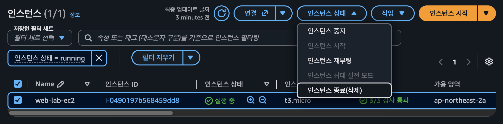

**종료 완료 확인**

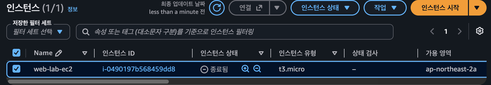

## 12-2. EBS 볼륨 잔존 확인

EC2 종료 후 EBS 볼륨 목록에서 **현재 이 리전에 볼륨이 없습니다**를 확인했다. 남아 있는 볼륨이 없어 추가 삭제 대상이 없었다.

**EBS 볼륨 잔존 없음**

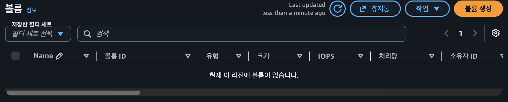

## 12-3. Elastic IP 잔존 확인

탄력적 IP 목록에서 **이 리전에서 탄력적 IP 주소를 찾을 수 없음**을 확인했다. 별도로 릴리스할 주소가 남아 있지 않았다.

**Elastic IP 잔존 없음**

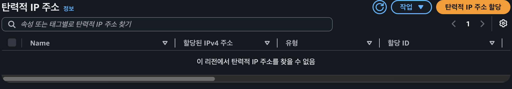

## 12-4. Public Subnet 삭제

`web-lab-public-subnet` (`subnet-0c1774cc3cf2af370`) 선택 → **작업 → 서브넷 삭제** → 확인 팝업에서 `삭제` 입력 후 삭제를 진행했다.

팝업에는 `ram:GetResourceShareAssociations` 권한 부족으로 **리소스 공유 정보를 로드하지 못했다**는 경고가 표시되었다. 이는 삭제 완료 메시지가 아니며, 해당 권한을 추가했다는 기록은 없다. 서브넷을 포함한 VPC 정리 완료는 사용자 확인을 근거로 기록한다.

**서브넷 삭제 메뉴**

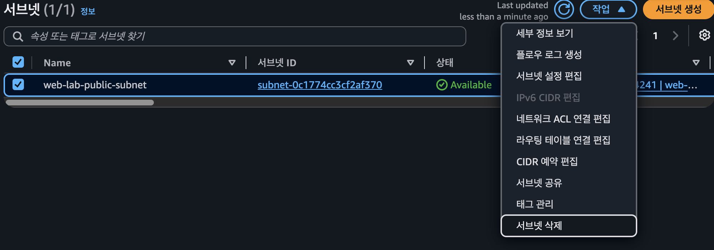

**서브넷 삭제 확인 팝업**

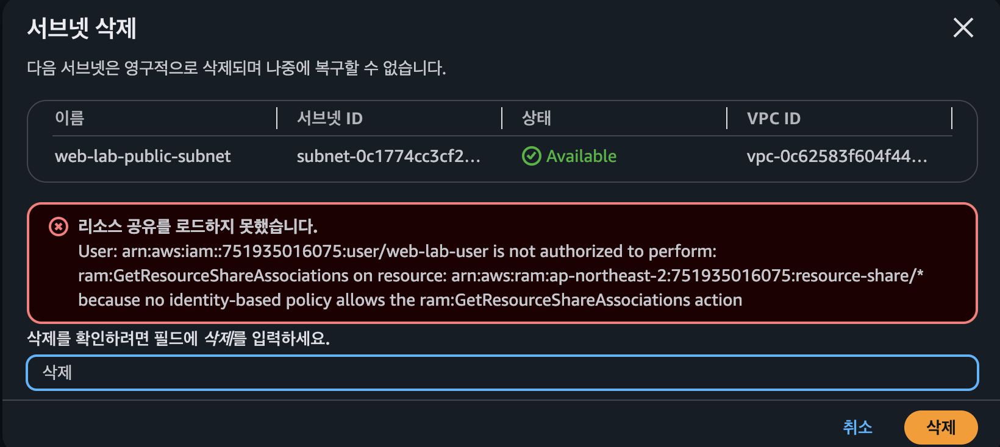

## 12-5. Route Table 삭제

삭제 메뉴와 확인 팝업에서 사용자 생성 테이블 `web-lab-public-rt` (`rtb-01d574886538f56d6`)를 삭제 대상으로 확인했다. 함께 선택된 기본 테이블 `rtb-02c02bec3484cc78e`는 개별 삭제할 수 없다는 안내가 나타났다. 사용자 생성 테이블을 삭제하고 기본 테이블은 VPC 삭제 시 함께 정리하는 순서로 진행했다.

**라우팅 테이블 삭제 메뉴**

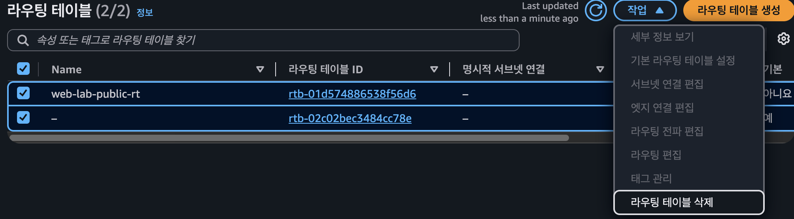

**삭제 가능 테이블과 기본 테이블 구분**

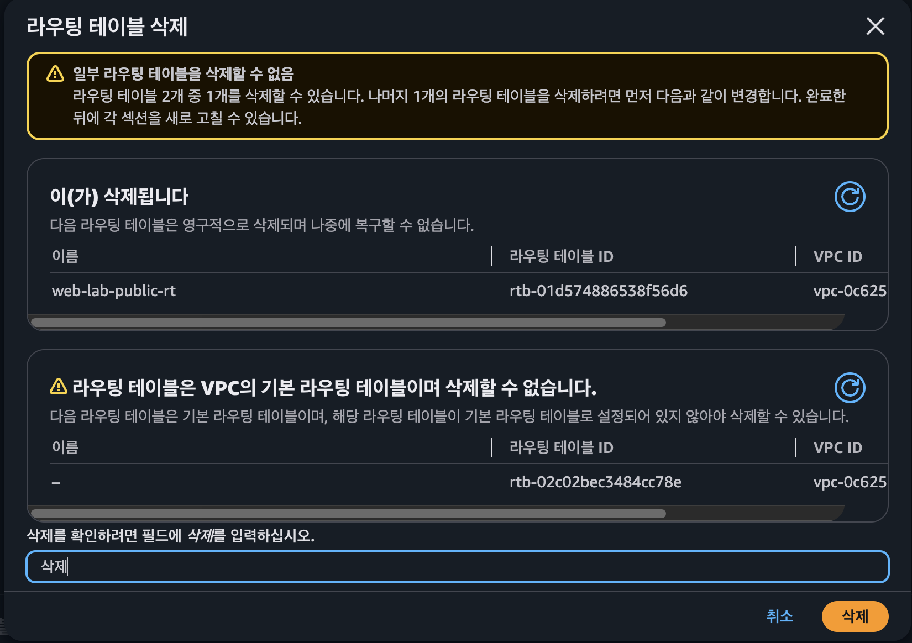

## 12-6. Security Group 삭제

`web-lab-sg` (`sg-0ab95537414997679`)를 삭제했다. 팝업에서 해당 그룹은 **연결된 리소스 없음 / 삭제될 예정**으로 표시되었다. 함께 선택된 기본 그룹 `sg-0663596cac84f2c43`은 개별 삭제 대상에서 제외되며, VPC 삭제 시 함께 정리된다.

**보안 그룹 삭제 메뉴**

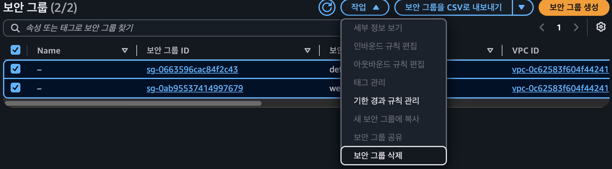

**실습 그룹과 기본 그룹의 삭제 가능 여부**

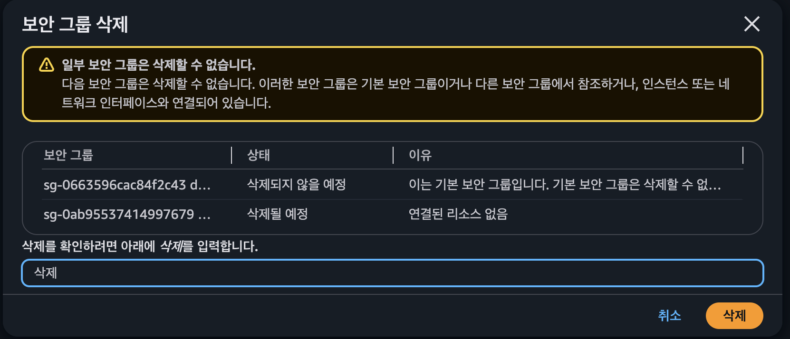

## 12-7. Internet Gateway 분리 및 삭제

`web-lab-igw` (`igw-0b643cdd8ed2935a5`) 선택 → **VPC에서 분리** → 팝업에서 `분리` 입력 후 실행했다. 이후 목록에서 **Detached** 상태를 확인하고, 삭제 메뉴 → 확인 팝업 순서로 삭제했다.

**IGW 분리 메뉴**

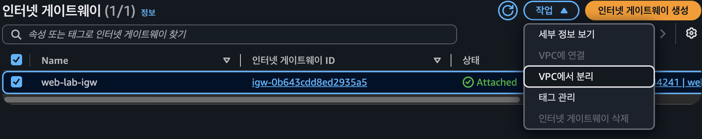

**IGW 분리 확인 팝업**

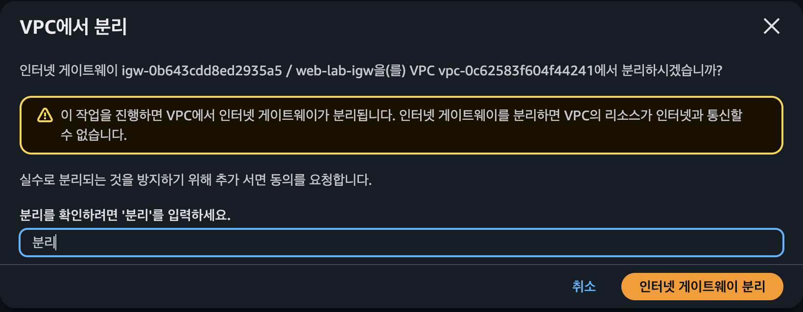

**Detached 확인 및 삭제 메뉴**

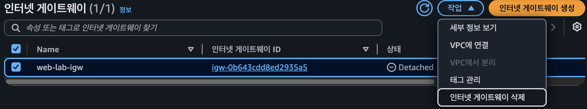

**IGW 삭제 확인 팝업**

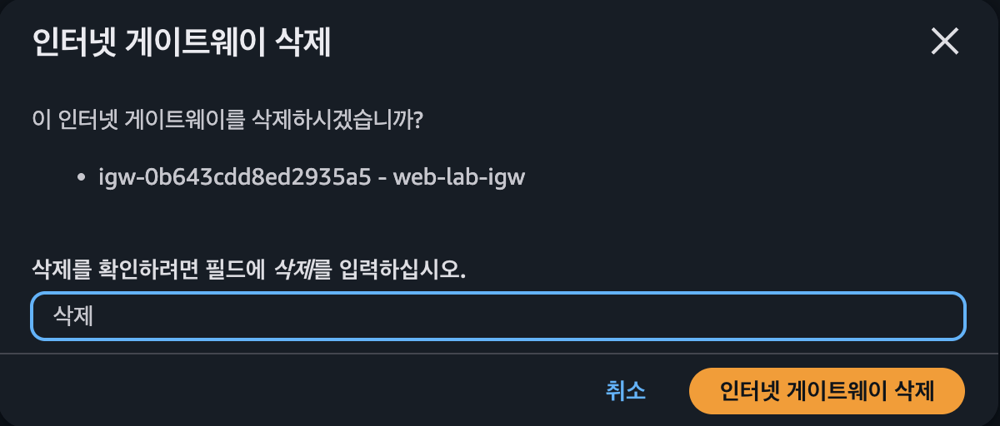

## 12-8. VPC 삭제

마지막으로 `web-lab-vpc` (`vpc-0c62583f604f44241`) 선택 → **작업 → VPC 삭제** → 팝업에서 `삭제` 입력 후 삭제를 완료했다. 삭제 완료는 사용자 확인을 근거로 기록하며, 첨부 팝업은 최종 실행 전 확인 화면이다.

**VPC 삭제 메뉴**

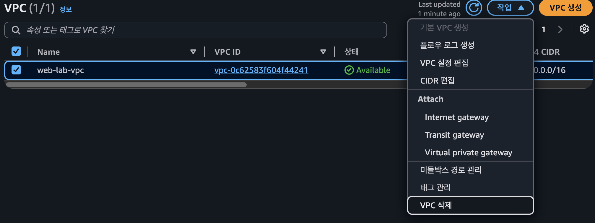

**VPC 삭제 확인 팝업**

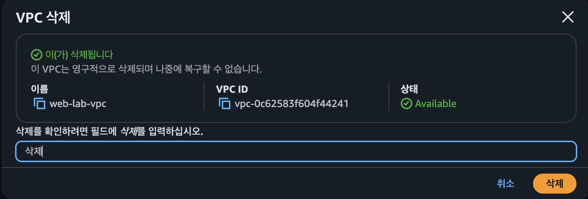

# 13. 최종 진행 상태

웹 서비스 배포, 내부·외부 통신 검증, 아키텍처 다이어그램, 트러블슈팅 보고서와 주요 리소스 정리 기록을 작성했다. EC2 종료 및 VPC 삭제로 기존 공개 URL은 더 이상 실습 서비스의 접속 주소로 사용하지 않는다.

주요 정리 결과와 근거는 [리소스 정리 체크리스트](docs/cleanup-checklist.md)에 기록했다.
