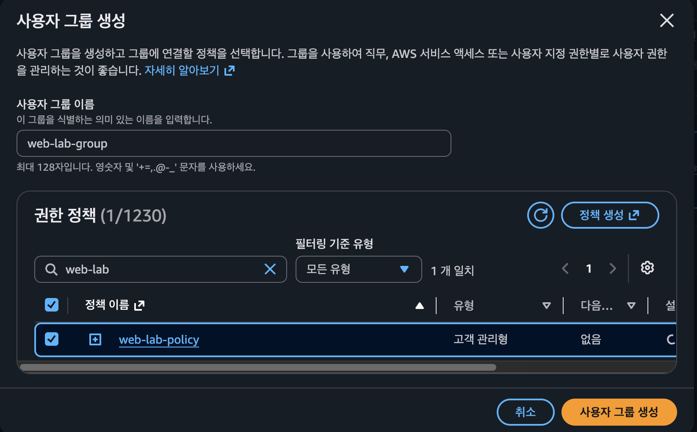
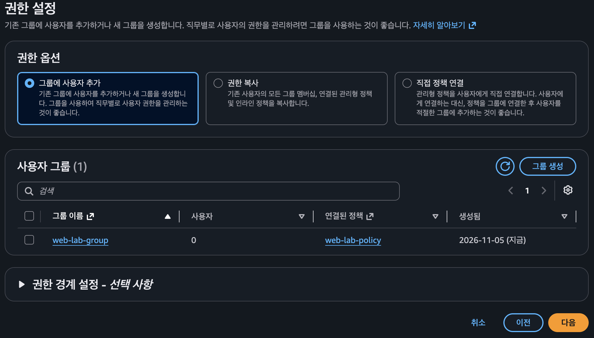
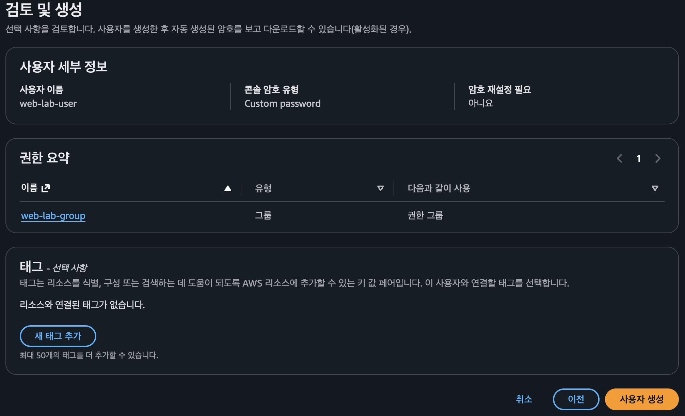
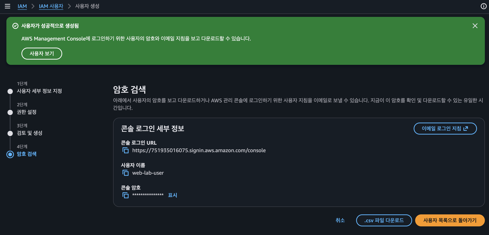
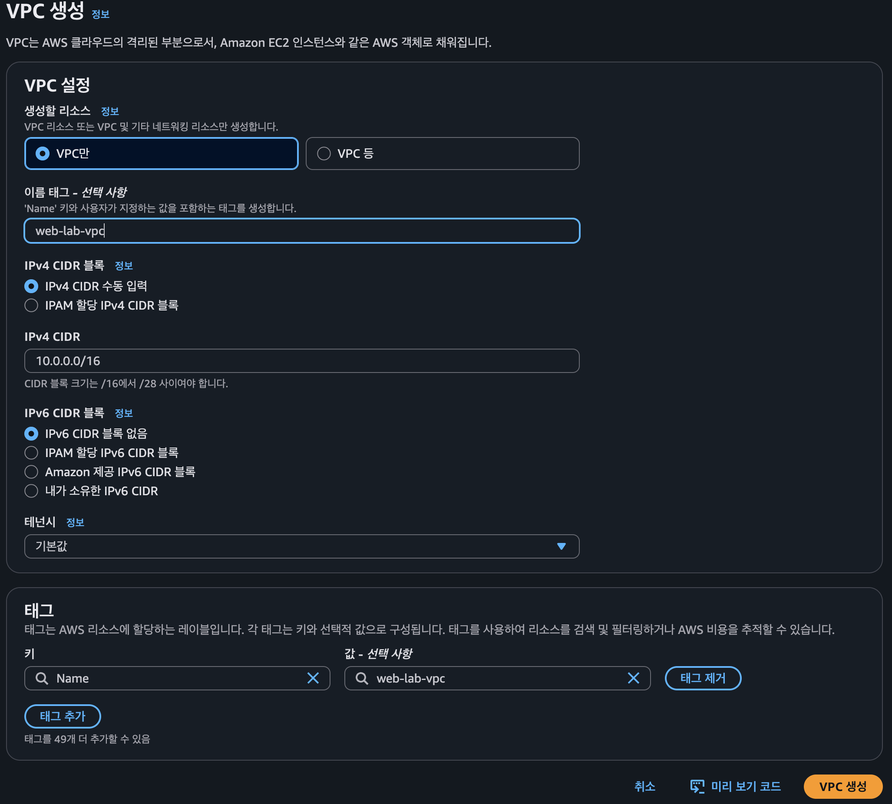

# 1. IAM->정책->정책생성
정책 편집기에서 (JSON으로 선택후) 아래내용 붙여넣음
```
{
  "Version": "2012-10-17",
  "Statement": [
    {
      "Sid": "AllowReadEC2AndVPC",
      "Effect": "Allow",
      "Action": [
        "ec2:Describe*",
        "ec2:GetConsoleOutput",
        "ec2:GetConsoleScreenshot"
      ],
      "Resource": "*",
      "Condition": {
        "StringEquals": {
          "aws:RequestedRegion": "ap-northeast-2"
        }
      }
    },
    {
      "Sid": "AllowWebLabManagement",
      "Effect": "Allow",
      "Action": [
        "ec2:CreateVpc",
        "ec2:DeleteVpc",
        "ec2:CreateSubnet",
        "ec2:DeleteSubnet",
        "ec2:ModifySubnetAttribute",
        "ec2:CreateInternetGateway",
        "ec2:AttachInternetGateway",
        "ec2:DetachInternetGateway",
        "ec2:DeleteInternetGateway",
        "ec2:CreateRouteTable",
        "ec2:DeleteRouteTable",
        "ec2:CreateRoute",
        "ec2:DeleteRoute",
        "ec2:AssociateRouteTable",
        "ec2:DisassociateRouteTable",
        "ec2:CreateSecurityGroup",
        "ec2:DeleteSecurityGroup",
        "ec2:AuthorizeSecurityGroupIngress",
        "ec2:RevokeSecurityGroupIngress",
        "ec2:AuthorizeSecurityGroupEgress",
        "ec2:RevokeSecurityGroupEgress",
        "ec2:CreateKeyPair",
        "ec2:DeleteKeyPair",
        "ec2:RunInstances",
        "ec2:TerminateInstances",
        "ec2:CreateTags",
        "ec2:DeleteVolume"
      ],
      "Resource": "*",
      "Condition": {
        "StringEquals": {
          "aws:RequestedRegion": "ap-northeast-2"
        }
      }
    }
  ]
}
```
JSON을 입력한 다음
1. 다음(Next) 버튼을 클릭합니다.
2. 정책 이름에 web-lab-policy를 입력합니다.
3. 설명에 AWS EC2 VPC Web Lab Permissions를 입력합니다.
4. 정책 생성(Create policy)을 클릭합니다.

# 2. IAM->IAM 사용자->그룹생성
IAM > IAM 사용자 > 사용자 생성 에서 그룹생성 버튼을 눌러서 사용자 그룹을 생성한다

사용자 그룹이름은 web-lab-group 으로 입력하고 
권한정책은 검색창에 web-lab으로 입력한 후 정책생성버튼의 동그라미형태의 Refresh버튼을 누르고
web-lab-policy 정책이 화면에 보이면 체크박스를 선택한다.
그리고 사용자 그룹 생성 버튼을 클릭한다.
 



# 3. VPC생성
위에서 생성된 IAM 사용자 로그인 URL을 확인하고 보관합니다.
## STEP 1. 새로운 IAM 사용자로 로그인
1. 현재 AWS 콘솔에서 로그아웃합니다.
2. IAM 사용자 로그인 페이지로 이동합니다.
3. 다음 정보를 입력합니다.
항목	입력
계정 ID	본인 AWS 계정의 12자리 ID
IAM 사용자 이름	web-lab-user
암호	사용자 생성 시 설정한 암호

## STEP 2. 서울 리전 선택
AWS 콘솔 오른쪽 위의 리전 선택 메뉴에서 다음을 선택합니다.

아시아 태평양(서울) ap-northeast-2

IAM 화면에서는 글로벌이라고 표시될 수 있지만, VPC를 만드는 화면에서는 서울 리전이어야 합니다.

## STEP 3. VPC 생성
AWS 콘솔 상단 검색창에 VPC 입력

VPC → Your VPCs(VPC) → Create VPC(VPC 생성) 선택

다음과 같이 입력합니다.
항목	설정값
생성할 리소스	VPC만(VPC only)
이름 태그	web-lab-vpc
IPv4 CIDR	10.0.0.0/16
IPv6 CIDR	IPv6 CIDR 블록 없음
테넌시	기본값(Default)

VPC 생성 후의 상태
VPC: web-lab-vpc

10.0.0.0/16
아직 Subnet과 EC2를 생성하지 않은 상태

마지막으로 VPC 생성(Create VPC) 버튼을 클릭합니다.

VPC가 정상적으로 생성되면 상태가 Available로 나타납니다.
