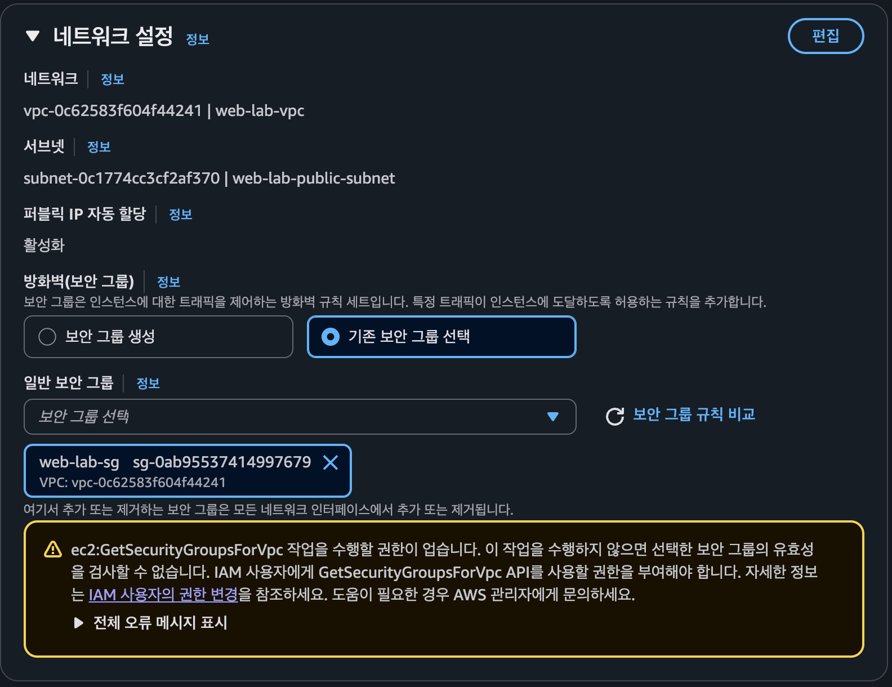

# 트러블슈팅 보고서

## 1. SSH 개인 키 파일 권한으로 인한 접속 실패

### 증상
Mac에서 EC2에 SSH 접속을 시도했으나 다음 오류가 발생했다.
```
thinkover20221658@c4r6s1 B3-1 % ssh -i ~/Documents/web-lab-key.pem ubuntu@54.180.230.112
The authenticity of host '54.180.230.112 (54.180.230.112)' can't be established.
ED25519 key fingerprint is SHA256:zfwGIsUiRomNMtXYeIISdgTtxdFcKWTsysU5NaEQ8rU.
This key is not known by any other names.
Are you sure you want to continue connecting (yes/no/[fingerprint])? yes
Warning: Permanently added '54.180.230.112' (ED25519) to the list of known hosts.
@@@@@@@@@@@@@@@@@@@@@@@@@@@@@@@@@@@@@@@@@@@@@@@@@@@@@@@@@@@
@         WARNING: UNPROTECTED PRIVATE KEY FILE!          @
@@@@@@@@@@@@@@@@@@@@@@@@@@@@@@@@@@@@@@@@@@@@@@@@@@@@@@@@@@@
Permissions 0644 for '/Users/thinkover20221658/Documents/web-lab-key.pem' are too open.
It is required that your private key files are NOT accessible by others.
This private key will be ignored.
Load key "/Users/thinkover20221658/Documents/web-lab-key.pem": bad permissions
ubuntu@54.180.230.112: Permission denied (publickey).
```
### 가설
개인 키 파일에 다른 사용자의 읽기 권한이 있어,
SSH 클라이언트가 해당 키를 인증에 사용하지 않는 것으로 판단했다.

### 검증
오류 메시지에서 파일 권한이 0644임을 확인했다.
0644는 소유자에게 읽기·쓰기 권한을,
그룹과 다른 사용자에게 읽기 권한을 허용한다.
```
thinkover20221658@c4r6s1 B3-1 % ls -al ~/Documents/web-lab-key.pem 
-rw-r--r--@ 1 thinkover20221658  thinkover20221658  1674 11  5 19:39 /Users/thinkover20221658/Documents/web-lab-key.pem
```

### 조치
소유자만 개인 키를 읽을 수 있도록 권한을 0400으로 변경한다.
```
thinkover20221658@c4r6s1 B3-1 % chmod u-w,g-r,o-r ~/Documents/web-lab-key.pem 
thinkover20221658@c4r6s1 B3-1 % ls -al ~/Documents/web-lab-key.pem           
-r--------@ 1 thinkover20221658  thinkover20221658  1674 11  5 19:39 /Users/thinkover20221658/Documents/web-lab-key.pem
```
### 결과
- 조치 전: SSH가 개인 키를 무시하여 인증 실패.
- 조치 후: 재접속 성공.
```
thinkover20221658@c4r6s1 B3-1 % ssh -i ~/Documents/web-lab-key.pem ubuntu@54.180.230.112
Welcome to Ubuntu 24.04.5 LTS (GNU/Linux 7.0.0-1014-aws x86_64)

 * Documentation:  https://help.ubuntu.com
 * Management:     https://landscape.canonical.com
 * Support:        https://ubuntu.com/pro

 System information as of Fri Nov  6 02:19:10 UTC 2026

  System load:  0.0               Temperature:           -273.1 C
  Usage of /:   33.8% of 6.71GB   Processes:             116
  Memory usage: 26%               Users logged in:       0
  Swap usage:   0%                IPv4 address for ens5: 10.0.1.117

 * Ubuntu Pro delivers the most comprehensive open source security and
   compliance features.

   https://ubuntu.com/aws/pro

Expanded Security Maintenance for Applications is not enabled.

27 updates can be applied immediately.
19 of these updates are standard security updates.
To see these additional updates run: apt list --upgradable

Enable ESM Apps to receive additional future security updates.
See https://ubuntu.com/esm or run: sudo pro status


The programs included with the Ubuntu system are free software;
the exact distribution terms for each program are described in the
individual files in /usr/share/doc/*/copyright.

Ubuntu comes with ABSOLUTELY NO WARRANTY, to the extent permitted by
applicable law.

To run a command as administrator (user "root"), use "sudo <command>".
See "man sudo_root" for details.

ubuntu@ip-10-0-1-117:~$ 
ubuntu@ip-10-0-1-117:~$ uname -a
Linux ip-10-0-1-117 7.0.0-1014-aws #14~24.04.1-Ubuntu SMP PREEMPT Fri Sep 18 21:24:59 UTC 2026 x86_64 x86_64 x86_64 GNU/Linux
ubuntu@ip-10-0-1-117:~$ lsb_release -a
No LSB modules are available.
Distributor ID:	Ubuntu
Description:	Ubuntu 24.04.5 LTS
Release:	24.04
Codename:	noble
```

### 재발 방지
- 키페어 다운로드 후 사용 전에 파일 권한을 0400으로 설정한다.
- SSH 접속 체크리스트에 개인 키 권한 확인 항목을 추가한다.
- 개인 키는 Git 저장소에 커밋하거나 타인에게 공유하지 않는다.

## 2. EC2 인스턴스 생성 시 네트워크 설정의 권한 오류

### 증상

인스턴스 생성 화면의 네트워크 설정에서 기존 보안 그룹 `web-lab-sg`를 선택하자, `ec2:GetSecurityGroupsForVpc` 권한이 없어 보안 그룹의 유효성을 검사할 수 없다는 경고가 발생했다.



### 가설

실습 사용자에게 적용된 정책에 보안 그룹 조회 작업인 `ec2:GetSecurityGroupsForVpc`가 누락된 것으로 판단했다.

### 검증

오류 메시지의 작업명과 정책을 비교했다. 기존 `ec2:Describe*`는 `ec2:GetSecurityGroupsForVpc`를 포함하지 않아 해당 조회 작업이 허용되지 않았다.

### 조치

루트 계정으로 로그인하여 `web-lab-user`에 적용된 정책의 EC2 조회용 `Action` 목록에 `ec2:GetSecurityGroupsForVpc`를 추가했다. 수정 후 목록은 다음과 같다.

```json
"Action": [
    "ec2:Describe*",
    "ec2:GetConsoleOutput",
    "ec2:GetConsoleScreenshot",
    "ec2:GetSecurityGroupsForVpc"
]
```

### 결과

**권한 추가 후 인스턴스 생성 화면의 네트워크 설정에서 발생한 보안 그룹 권한 오류가 해소되었다.** 해결된 작업은 EC2 보안 그룹 조회이며, `web-lab-user`의 IAM 정책 조회 권한을 추가한 것은 아니다.

### 재발 방지

- 콘솔 오류의 API 작업명을 정책의 `Action` 목록과 비교한다.
- `Describe*`가 모든 조회 작업을 포함한다고 가정하지 않고 필요한 권한만 추가한다.
